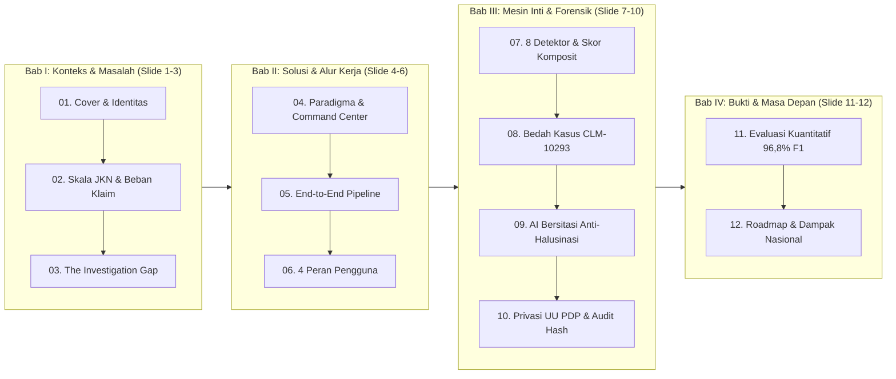

# Blueprint & Visual Product Deck (16:9) — ARSA: JKN Risk Intelligence Platform

> **Master Presentation Deck — Photorealistic Editorial Edition (16:9 Widescreen via Nano Banana)**
> Seluruh 12 slide di bawah ini dirancang dengan pendekatan **Photorealistic Editorial & Documentary Healthcare** (*Apple Healthcare Keynote × McKinsey Flagship Report*), rasio **16:9**, **top header bar konsisten (`#081F15`)** menggunakan aset logo resmi **`arsa_logo.png`** (`ARSA JKN · RISK INTELLIGENCE PLATFORM`), kanvas terang *Warm Alabaster* (`#F4F7F5`), serta fotografi dokumenter layanan kesehatan Indonesia yang realistis (tanpa elemen 3D sci-fi/hologram).

---

## Galeri Interaktif 12 Slide (16:9 Widescreen)

````carousel

<!-- slide -->

<!-- slide -->

<!-- slide -->

<!-- slide -->

<!-- slide -->

<!-- slide -->

<!-- slide -->

<!-- slide -->

<!-- slide -->

<!-- slide -->

<!-- slide -->

````

---

## 1. Fondasi Narasi & Positioning Produk

### 1.1 Tesis Utama (Core Narrative)
Sistem pendeteksi klaim tradisional menghasilkan **ribuan *alert* probabilitas tinggi tanpa konteks**, sehingga verifikator tetap harus membuka berkas satu per satu secara manual.
> **"ARSA tidak meminta auditor memercayai skor prediksi AI — ARSA menyajikan bukti kontradiksi rekam medis yang langsung dapat diverifikasi manusia."**

### 1.2 Pilar Positioning ("Apa itu ARSA vs Bukan ARSA")
| Bukan Sekadar... | Melainkan... |
|---|---|
| Dashboard BI / grafik statistik klaim pasif | **End-to-End Investigation Workspace** dari triase hingga dosier PDF resmi |
| *Black-box fraud classifier* (skor 0–100 tanpa alasan) | **Hybrid Forensic Engine**: 8 detektor deterministik + vektor semantik (`pgvector`) + sitasi verbatim |
| Chatbot AI bebas yang rentan halusinasi | **Citation-Validated Copilot**: kalimat tanpa ID kutipan sumber valid otomatis ditolak/diganti |
| Alat yang mengambil alih keputusan verifikator | **Human-in-the-Loop Governance** dengan RBAC 3 peran & rantai hash audit SHA-256 |

### 1.3 Alur Cerita Deck (Story Arc — 12 Slide Utama)


---

## 2. Sistem Desain Visual Deck (Photorealistic Editorial DNA)

- **Gaya Visual:** *Photorealistic Editorial & Documentary Healthcare Keynote* (*Apple Healthcare Keynote × McKinsey Flagship Report × Financial Times Editorial*, Rasio **16:9 Widescreen**, bebas dari elemen 3D sci-fi/hologram).
- **Kanvas & Fotografi:** Kanvas *Warm Alabaster & Soft Sage* (`#F4F7F5`) yang dipadukan dengan fotografi dokumenter DSLR realistis (lensa 35mm, pencahayaan natural rumah sakit/kantor verifikasi di Indonesia, berkas rekam medis fisik *flat-lay*, serta kartu informasi bergaya *Swiss Editorial Grid*).
- **Aksen Warna:**
  - **Deep Matte Forest (`#081F15` / `#0B291C`) & BPJS Emerald (`#00A651`):** Bar header utama, kartu ringkasan eksekutif, bukti terverifikasi, dan metrik akurasi.
  - **Clinical Crimson (`#DC2626`) & Amber (`#D97706`):** Sorotan stabilo merah pada kutipan kontradiksi rekam medis (`CLM-10293`), stempel selisih eksposur (`Rp 14,45 Jt`), dan indikator risiko kritis (`99/100`).
- **Konsistensi Header Bar & Aset Logo:**
  - **Kiri Atas (Header Bar `#081F15`):** Menggunakan aset logo resmi [`arsa_logo.png`](file:///c:/Users/Aril%20Indra%20Permana/HealthKathon/public/arsa_logo.png) (emblem pita hijau lipat huruf "A") + teks putih `ARSA JKN · RISK INTELLIGENCE PLATFORM`.
  - **Kanan Atas (Header Bar `#081F15`):** *Pill badge* nomor urut slide yang konsisten (`01 / 12` s.d. `12 / 12`).

---

## 3. Blueprint & Hasil Render Slide demi Slide (01 – 12)

---

### SLIDE 01 — Cover: Identitas Produk & Pernyataan Visi (`01 / 12`)


- **Tujuan Slide:** Memberikan kesan pertama kelas *enterprise keynote* dan langsung memvisualisasikan pembeda utama ARSA: bedah anatomi bukti klaim secara *exploded 3D* (`CLM-10293 · RISK SCORE 99/100`).
- **Pesan Utama:**
  - **Eyebrow:** `INDONESIA NATIONAL HEALTH INSURANCE · AI FORENSIC PLATFORM`
  - **Headline:** **MENJAGA AKUNTABILITAS DANA JKN**
  - **Subheadline:** *Explainable Risk Intelligence & Verbatim Evidence Investigation*
  - **3 Pilar Inti:** `DETECT · 8 Engines` · `INVESTIGATE · Verbatim Proof` · `DECIDE · SHA-256 Audit`

---

### SLIDE 02 — Konteks & Urgensi: Skala Ekosistem Kesehatan Nasional (`02 / 12`)


- **Tujuan Slide:** Menunjukkan skala masif JKN di 38 provinsi Indonesia dan mengapa kebocoran sekecil apa pun berdampak triliunan rupiah terhadap layanan peserta.
- **Pesan Utama & Metrik Makro:**
  - **Headline:** **PENGAWASAN KLAIM TRILIUNAN RUPIAH**
  - **3 Monumen Data Utama:**
    1. **275+ JUTA:** Peserta Aktif JKN (*Universal Coverage*) di seluruh kepulauan Indonesia.
    2. **Rp 165+ TRILIUN:** Belanja Klaim INA-CBG / Tahun lintas ribuan FKTP & FKRTL.
    3. **3% – 10%:** Eksposur Risiko Inefisiensi & Fraud menurut tolok ukur global (OECD/ACFE).
  - **4 Tipologi Risiko Utama:** *Upcoding Severity*, *Phantom Billing*, *Cloning Resume*, dan *Unbundling Episode*.

---

### SLIDE 03 — Masalah Inti: *The Investigation Gap* (`03 / 12`)


- **Tujuan Slide:** Memvisualisasikan titik kemacetan (*bottleneck funnel*) 30–45 menit/berkas akibat sistem lama yang hanya memuntahkan ribuan *alert* tanpa kutipan bukti.
- **Pesan Utama:**
  - **Headline:** **BANJIR ALERT TANPA BUKTI KONTRADIKSI**
  - **3 Kelemahan Fatal Sistem Lama:**
    1. **BLACK-BOX SCORE:** Skor probabilitas tanpa kutipan bukti medis yang dapat dipertanggungjawabkan auditor.
    2. **SILOED REVIEW:** Buta terhadap pola lintas-berkas dan *cloning* narasi antar pasien berbeda.
    3. **AI HALLUCINATION:** Chatbot LLM umum rawan mengarang kesimpulan medis dan membocorkan data pribadi (PII).

---

### SLIDE 04 — Solusi Produk: Paradigma Baru Intelijen Klaim (`04 / 12`)


- **Tujuan Slide:** Memperkenalkan antarmuka spasial **ARSA Executive Command Center** beserta 4 kapabilitas inti yang mengelilinginya.
- **Pesan Utama:**
  - **Headline:** **PLATFORM INVESTIGASI BERBASIS BUKTI & AI TERVERIFIKASI**
  - **Telemetri Sensus:** `1.202 Klaim Sensus` · `341 Risiko Tinggi` · `Rp 1,33 M Eksposur` · `97,3% F1-Score`.
  - **4 Modul Orbit Inti:**
    1. `01 · ATURAN KLINIS INA-CBG & BENCHMARK PEER`
    2. `02 · FORENSIK VEKTOR pgvector & LINTAS DOKUMEN`
    3. `03 · AI COPILOT DENGAN SITASI VERBATIM`
    4. `04 · ANONIMISASI UU PDP & RANTAI HASH SHA-256`

---

### SLIDE 05 — Arsitektur Alur Kerja End-to-End (`05 / 12`)


- **Tujuan Slide:** Menunjukkan pipa pemrosesan 6 stasiun dari input data SIMRS/e-Klaim hingga dosier PDF bersegel SHA-256, lengkap dengan **3 Gerbang Kendali Manusia (*Human Gates*)**.
- **Pesan Utama:**
  - **Headline:** **AMAN SEJAK INPUT, TRANSPARAN HINGGA KEPUTUSAN**
  - **6 Stasiun Terintegrasi:**
    1. `01 · INGEST SIMRS & e-KLAIM` (Batch CSV, XLSX, JSON multi-format rumah sakit)
    2. `02 · ANONIMISASI UU PDP` (Tokenisasi `HMAC-SHA256` di memori sebelum masuk database)
    3. `03 · AI SCHEMA MAPPER` (Pemetaan 13/13 kolom otomatis + **Human Gate #1**)
    4. `04 · 8 DETEKTOR + pgvector` (Pemindaian aturan klinis & indeks vektor HNSW paralel)
    5. `05 · EVIDENCE WORKSPACE & COPILOT` (Papan bukti & AI bersitasi + **Human Gate #2**)
    6. `06 · SUPERVISOR & DOSIER PDF` (Keputusan akhir + rantai hash SHA-256 + **Human Gate #3**)

---

### SLIDE 06 — Pengalaman Pengguna Berbasis Peran (`06 / 12`)


- **Tujuan Slide:** Menunjukkan bagaimana **ARSA Core** melayani 4 ruang kerja spesifik untuk 4 pemangku kepentingan pengawasan JKN.
- **Pesan Utama:**
  - **Headline:** **SATU EKOSISTEM UNTUK EMPAT PERAN PENGAWASAN**
  - **4 Portal Ruang Kerja:**
    1. **01 · VERIFIKATOR KLAIM:** *Fast Triage Queue HUD* dengan prioritas skor risiko (`99`, `94`, `88`) dan nilai eksposur Rupiah.
    2. **02 · AUDITOR FORENSIK:** *Deep Forensic Evidence Board HUD*, perbandingan dokumen berdampingan, *Fraud Network Graph*, dan kutipan AI Copilot.
    3. **03 · EKSEKUTIF & KEBIJAKAN:** *3D Geospatial Risk Map* 38 provinsi, kurva tren eksposur finansial, dan radar anomali 14 hari.
    4. **04 · TIM DATA & SIMRS:** *Technical Data Governance HUD* dengan status perisai privasi UU PDP, pemetaan kolom `13/13`, dan kalibrasi presisi/recall (`96,8% F1`).

---

### SLIDE 07 — Mesin Deteksi Hibrida: 8 Detektor & Skor Komposit (`07 / 12`)


- **Tujuan Slide:** Membedah jantung analitik ARSA: inti skor komposit `0–100` yang dikelilingi 8 modul detektor spesialis beserta bobot kontribusinya.
- **Pesan Utama:**
  - **Headline:** **8 DETEKTOR SPESIALIS & SKOR RISIKO KOMPOSIT**
  - **8 Modul Detektor (`lib/risk/detectors.ts`):**
    1. **UPCODING (Bobot 28%):** *Severity Level II/III* tanpa dukungan bukti komorbiditas.
    2. **PHANTOM BILLING (Bobot 26%):** Tagihan prosedur bedah tanpa laporan kamar operasi (OK).
    3. **CLONING (Bobot 22%):** Kemiripan vektor `pgvector >= 92%` & tumpang-tindih frasa 3-gram lintas pasien.
    4. **INFLATED BILL (Bobot 20%):** Tagihan melampaui `> 2,5x` median rumah sakit *peer* setara.
    5. **UNBUNDLING (Bobot 18%):** Pemecahan episode rawat berdekatan (`<= 7 hari`).
    6. **ABNORMAL LOS (Bobot 14%):** Lama rawat inap (*Length of Stay*) di luar persentil `P10–P90`.
    7. **REPEAT CHURN (Bobot 12%):** Pola penagihan dan rujukan berulang pada pasangan dokter–faskes.
    8. **EMERGING SIGNAL (Bobot 12%):** Lonjakan pola anomali baru dalam jendela 14 hari terakhir.

---

### SLIDE 08 — Studi Kasus Forensik Nyata: Klaim `CLM-10293` (`08 / 12`)


- **Tujuan Slide:** Memberikan momen *"Aha!"* paling kuat dengan menyandingkan tablet **Tagihan INA-CBG** vs **Rekam Medis Verbatim** yang dihubungkan oleh jembatan laser kontradiksi, serta **Graf Relasi Entitas**.
- **Pesan Utama:**
  - **Headline:** **KONTRADIKSI TAGIHAN BEDAH VS CATATAN MEDIS**
  - **Anatomi Bukti `CLM-10293`:**
    - **Sisi Tagihan:** Diagnosis *Gastroenteritis Akut · Severity III*, Kode Tindakan `44.95 (Laparoscopic Surgery)`, ditagihkan **Rp 18.450.000** (padahal Median Peer RS Kelas B hanya **Rp 3.992.229** → **Selisih Eksposur Rp 14.457.771 / 4,6x Median Peer**).
    - **Sisi Rekam Medis Verbatim:** *"Dirawat 2 hari di bangsal biasa, rehidrasi RL 20 tpm. Tidak ada laporan maupun tindakan operasi."* + terdeteksi **99,6% Cloning Similarity** dengan klaim `CLM-09283`.
    - **Graf Relasi:** Menghubungkan `CLM-10293` dengan `dr. Hendra, Sp.PD`, `RS Sehat Sentosa`, dan berkas kembar `CLM-09283`.

---

### SLIDE 09 — AI Pendukung Keputusan Tanpa Halusinasi (`09 / 12`)


- **Tujuan Slide:** Menjelaskan arsitektur **Citation Validator Gate (`lib/ai/citations.ts`)** yang menjamin AI Copilot tidak pernah bisa menyelundupkan kutipan palsu ke meja supervisor.
- **Pesan Utama:**
  - **Headline:** **AI PENDUKUNG KEPUTUSAN TANPA HALUSINASI**
  - **Mekanisme Gerbang Validasi Sitasi:**
    - Setiap temuan pada AI Copilot wajib menautkan chip sitasi terverifikasi (`[SITASI #1 · DOC-10293-02]`, `[SITASI #3 · DOC-10293-04]`) yang terhubung langsung ke kartu dokumen medis asli.
    - **Jalur Hijau (*Validated Citation*):** Kutipan dan ID dokumen yang sah lolos menuju *Supervisor Decision Brief*.
    - **Jalur Merah (*Hallucination Blocked*):** Pernyataan tanpa bukti sumber sah otomatis dicegat oleh perisai **ZERO FABRICATED EVIDENCE** dan digantikan oleh ringkasan deterministik.

---

### SLIDE 10 — Privasi UU PDP & Rantai Audit SHA-256 (`10 / 12`)


- **Tujuan Slide:** Menunjukkan kepatuhan penuh terhadap **UU Pelindungan Data Pribadi No. 27 Tahun 2022** dan ketahanan bukti hukum melalui rantai blok hash **SHA-256**.
- **Pesan Utama:**
  - **Headline:** **KEPATUHAN UU PDP & RANTAI AUDIT SHA-256**
  - **Dua Zona Keamanan Kriptografis:**
    1. **Perisai Privasi UU PDP No. 27/2022:** Kartu identitas mentah pasien (`NIK`, `No. BPJS`, `Nama Pasien`) dianonimkan secara satu arah saat *ingest* menjadi token `HMAC-SHA256: PAT-8F92A1` dengan **0 PII Mentah** di dalam database.
    2. **Rantai Audit Tak Terubah (*SHA-256 Hash Chain*):** Setiap langkah mulai dari `BLOCK #1041 (Ingest & Anonimisasi)`, `BLOCK #1042 (Deteksi 8 Engine)`, hingga `BLOCK #1043 (Keputusan Supervisor)` saling mengunci secara kriptografis dan dicetak pada **Dokumen Forensik Resmi (PDF)**.

---

### SLIDE 11 — Validasi Kuantitatif & Benchmark Empiris (`11 / 12`)


- **Tujuan Slide:** Membuktikan keunggulan kuantitatif ARSA pada benchmark 1.202 klaim JKN terkalibrasi BPJS dibandingkan *rule-screening* tradisional.
- **Pesan Utama:**
  - **Headline:** **AKURASI TINGGI YANG TERUJI SECARA KUANTITATIF**
  - **4 Cincin Metrik Utama:**
    - **97,3%** *Macro F1-Score*
    - **99,3%** *Presisi Deteksi*
    - **95,5%** *Recall Cakupan*
    - **< 3 MENIT** *Waktu Investigasi / Kasus* (**10x lebih cepat** dibanding 30–45 menit manual)
  - **Perbandingan Performa per Detektor:** *Cloning (98,5%)*, *Phantom Billing (97,2%)*, *Inflated Bill (96,9%)*, *Upcoding (96,4%)*, dan *Unbundling (95,8%)* — jauh melampaui *Rule-Screening Tradisional (61,4% F1 · False Positive Tinggi)*.

---

### SLIDE 12 — Peta Jalan Implementasi & Dampak Nasional (`12 / 12`)


- **Tujuan Slide:** Menutup presentasi dengan visi masa depan yang menginspirasi dan kesiapan produk untuk langsung didemonstrasikan (*Live Interactive Demo Ready*).
- **Pesan Utama:**
  - **Headline:** **MASA DEPAN INTEGRITAS JKN DIMULAI HARI INI**
  - **3 Fase Lintasan Implementasi:**
    1. **FASE 1 · PRODUCTION MVP (SELESAI 100%):** 8 Detektor, `pgvector`, AI Copilot Bersitasi, Anonimisasi UU PDP & Audit SHA-256.
    2. **FASE 2 · FEDERATED HOSPITAL NETWORK:** Konektor *Real-Time* VClaim / e-Klaim & Pra-Audit Mandiri Rumah Sakit sebelum klaim dikirim.
    3. **FASE 3 · NATIONAL RISK INTELLIGENCE:** *Early-Warning* epidemiologi & perumusan kebijakan tarif berbasis bukti di 38 provinsi.
  - **Pernyataan Penutup:** *"Melindungi Dana Amanat Kesehatan 275+ Juta Rakyat Indonesia dengan Kecerdasan Buatan yang Jujur, Transparan, dan Dapat Diaudit."*

---

## 4. Lokasi File Gambar (Siap Pakai untuk PowerPoint / Canva / Keynote / PDF)

Seluruh 12 file gambar beresolusi **16:9** telah disimpan di dalam repositori proyek Anda:
- [`public/deck/slide-01.png`](file:///c:/Users/Aril%20Indra%20Permana/HealthKathon/public/deck/slide-01.png) — Cover: Menjaga Akuntabilitas Dana JKN
- [`public/deck/slide-02.png`](file:///c:/Users/Aril%20Indra%20Permana/HealthKathon/public/deck/slide-02.png) — Skala Ekosistem Kesehatan Nasional
- [`public/deck/slide-03.png`](file:///c:/Users/Aril%20Indra%20Permana/HealthKathon/public/deck/slide-03.png) — The Investigation Gap
- [`public/deck/slide-04.png`](file:///c:/Users/Aril%20Indra%20Permana/HealthKathon/public/deck/slide-04.png) — Platform Investigasi Berbasis Bukti & AI Terverifikasi
- [`public/deck/slide-05.png`](file:///c:/Users/Aril%20Indra%20Permana/HealthKathon/public/deck/slide-05.png) — End-to-End Investigation Pipeline
- [`public/deck/slide-06.png`](file:///c:/Users/Aril%20Indra%20Permana/HealthKathon/public/deck/slide-06.png) — Role-Based Intelligence Workspace (4 Peran)
- [`public/deck/slide-07.png`](file:///c:/Users/Aril%20Indra%20Permana/HealthKathon/public/deck/slide-07.png) — 8 Detektor Spesialis & Skor Risiko Komposit
- [`public/deck/slide-08.png`](file:///c:/Users/Aril%20Indra%20Permana/HealthKathon/public/deck/slide-08.png) — Studi Kasus Forensik `CLM-10293`
- [`public/deck/slide-09.png`](file:///c:/Users/Aril%20Indra%20Permana/HealthKathon/public/deck/slide-09.png) — Citation-Locked AI Copilot Tanpa Halusinasi
- [`public/deck/slide-10.png`](file:///c:/Users/Aril%20Indra%20Permana/HealthKathon/public/deck/slide-10.png) — Kepatuhan UU PDP & Rantai Audit SHA-256
- [`public/deck/slide-11.png`](file:///c:/Users/Aril%20Indra%20Permana/HealthKathon/public/deck/slide-11.png) — Empirical Benchmark & Validasi Kuantitatif
- [`public/deck/slide-12.png`](file:///c:/Users/Aril%20Indra%20Permana/HealthKathon/public/deck/slide-12.png) — Roadmap Implementasi & Dampak Nasional
