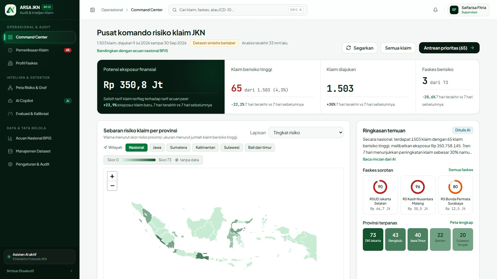
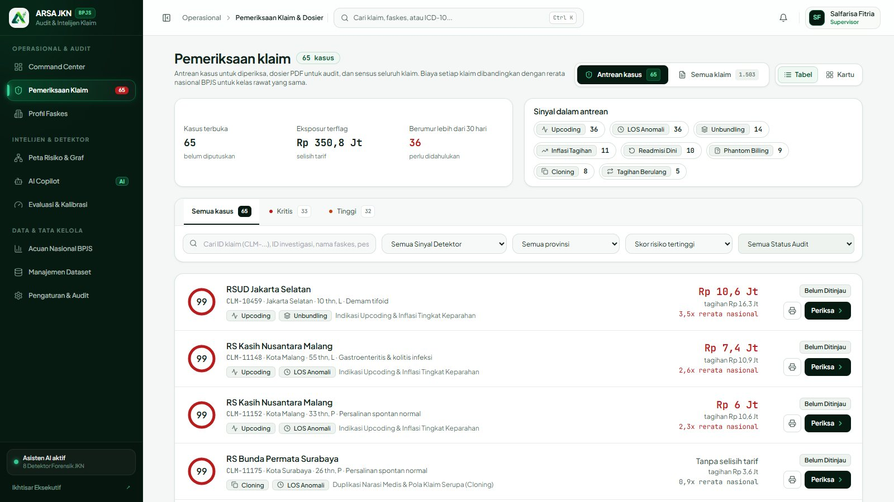
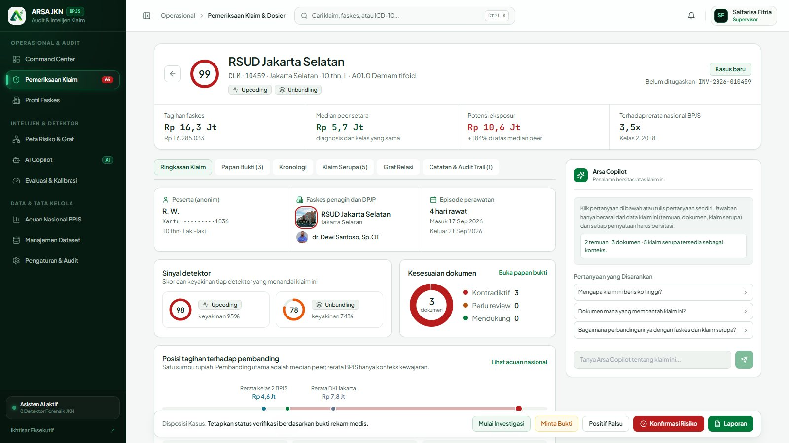
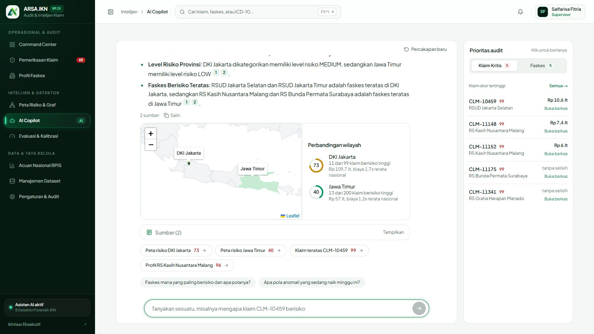
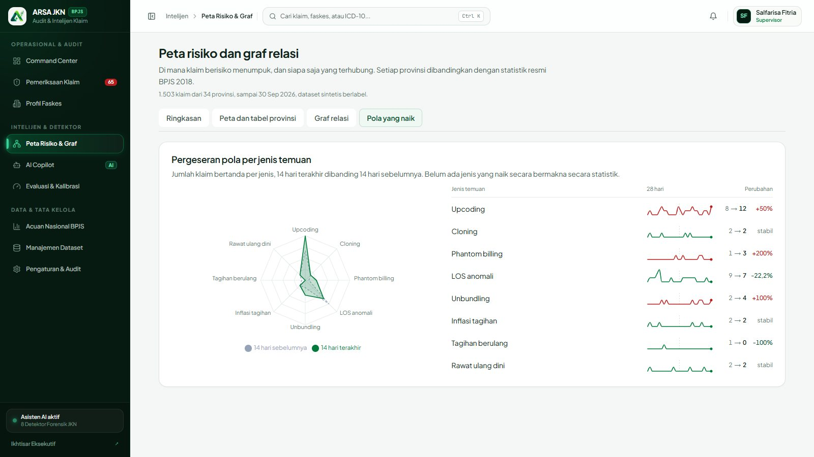
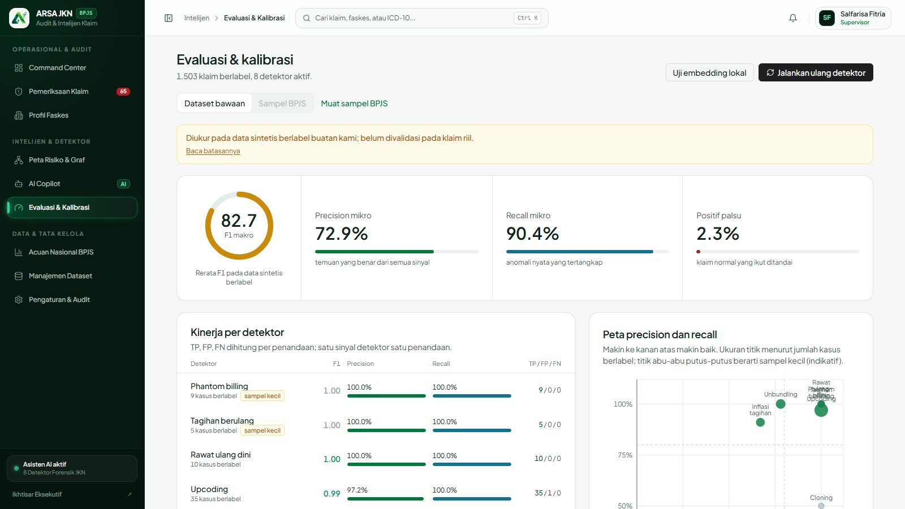
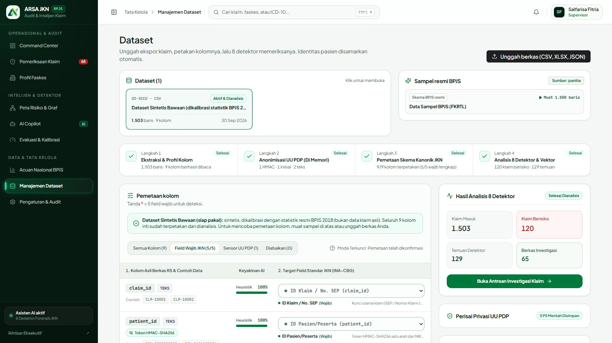
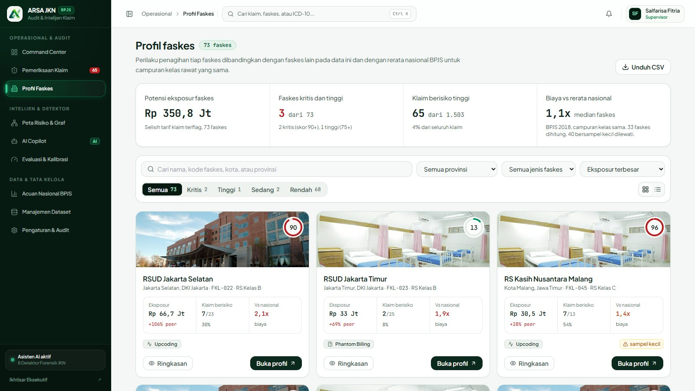
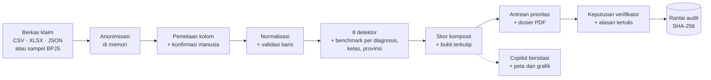

<div align="center">


# Arsa AI: JKN Risk Intelligence

**Menemukan klaim JKN yang perlu diperiksa, dan menunjukkan buktinya.**

*Healthkathon 2026 · Detect Smarter, Protect JKN · Kategori: Efisiensi Risiko pada fasilitas kesehatan*

[](https://arsa-jkn-hu3kknz2sa-et.a.run.app)
[](#pengujian)
[](#8-detektor-risiko)
[](#data-dan-kejujuran-metodologi)

[**Coba sekarang**](https://arsa-jkn-hu3kknz2sa-et.a.run.app) ·
[Fitur](#fitur-unggulan) ·
[Cara kerja](#cara-kerja) ·
[Menjalankan](#menjalankan-di-komputer-anda) ·
[Batasan](#data-dan-kejujuran-metodologi)



</div>

---

## Masalah yang kami selesaikan

Sistem pendeteksi klaim yang ada menghasilkan banyak peringatan **tanpa konteks**. Verifikator tetap harus membuka berkas satu per satu untuk tahu mengapa sebuah klaim ditandai. Skala JKN membuat itu mustahil: statistik resmi BPJS 2018 mencatat sekitar **11,1 juta admisi rawat inap tingkat lanjut**, rerata biaya klaim **Rp 4,75 juta** per admisi, dan **2.511** fasilitas rujukan yang bekerja sama.

> **Arsa AI tidak meminta auditor memercayai skor. Ia menyajikan bukti yang bisa diperiksa manusia.**

| Bukan sekadar | Melainkan |
|---|---|
| Dasbor statistik klaim yang pasif | **Ruang kerja investigasi** dari triase sampai dosier PDF |
| Pengklasifikasi kotak hitam (skor 0–100 tanpa alasan) | **Mesin hibrida**: 8 detektor deterministik + kemiripan semantik + sitasi verbatim |
| Chatbot AI bebas yang bisa berhalusinasi | **Copilot bersitasi**: kalimat tanpa sumber yang sah ditolak oleh validator |
| Alat yang mengambil alih keputusan | **Manusia memutuskan**: 3 peran, alasan tertulis wajib, rantai audit SHA-256 |

## Fitur unggulan

### 1. Command Center dan peta panas risiko
Ringkasan eksposur finansial, kasus berisiko, tren harian, **peta panas poligon provinsi** (putih ke hijau pekat menurut skor risiko), faskes dan provinsi paling menonjol, radar pergeseran pola 14 hari, serta umur kasus yang belum diputuskan. Semua angka dihitung dari data, bukan ditulis tangan.

### 2. Pemeriksaan klaim berbasis bukti
Antrean prioritas dengan skor berbentuk cincin, filter jenis temuan, dan satu baris per kasus. Halaman detail kasus memuat:
- **Skor per detektor** beserta keyakinannya,
- **Posisi tagihan pada satu sumbu rupiah**: tagihan ini vs median klaim sejenis vs rerata resmi BPJS (kelas rawat dan provinsi),
- **Papan bukti**: dokumen rekam medis yang mendukung atau bertentangan dengan klaim,
- **Klaim serupa** (peta kemiripan narasi), **graf relasi** dokter, faskes, dan pasien, serta kronologi,
- **Dosier PDF** untuk dibawa ke rapat.

<table>
<tr>
<td width="50%"></td>
<td width="50%"></td>
</tr>
<tr>
<td align="center"><sub>Antrean prioritas</sub></td>
<td align="center"><sub>Detail kasus: sinyal, dokumen, posisi tagihan</sub></td>
</tr>
</table>

### 3. Copilot bersitasi, dengan peta dan grafik di dalam jawaban
Tanya jawab dalam bahasa Indonesia. Setiap pernyataan wajib mengutip sumber (`[1]`, `[2]`); jawaban yang tidak lolos validasi otomatis **diganti jawaban berbasis aturan**. Untuk perbandingan wilayah, **peta provinsi dan cincin skor langsung tampil** di jawaban. Visual dihitung server dari data aplikasi, bukan dari teks model, sehingga tidak bisa "dikarang".



### 4. Pola risiko: radar dan tren per jenis temuan
Radar 8 jenis temuan (14 hari terakhir vs 14 hari sebelumnya) dengan garis tren 28 hari per jenis. Kenaikan hanya disebut "bermakna" bila lolos uji selisih Poisson, bukan sekadar naik dari 1 ke 3 klaim.

### 5. Evaluasi dan kalibrasi yang jujur
Precision, recall, F1, matriks TP/FP/FN, dan peta precision-recall per detektor, dibandingkan dengan ambang tunggal. Batasan "diukur pada data sintetis; belum divalidasi pada klaim riil" **selalu terlihat di halaman**, dan detektor berkasus di bawah 10 ditandai **sampel kecil**.

### 6. Unggah dataset dengan privasi sejak input
CSV, TSV, XLSX, dan JSON. Identitas pasien **disamarkan di memori** (HMAC, inisial, kolom identitas dibuang) sebelum apa pun disimpan. Kolom dipetakan otomatis ke skema kanonik JKN dan **dikonfirmasi manusia**. Baris bermasalah ditolak dengan alasan (ID duplikat, ID kosong, tagihan tidak valid). Alur ini diuji ujung ke ujung (12 tes, termasuk 5.000 baris).

### 7. Profil faskes, acuan nasional, dan tata kelola
- **Profil faskes**: skor, perbandingan dengan faskes lain, komposisi 8 detektor, tren bulanan, dokter penanggung jawab terkait.
- **Acuan nasional BPJS**: statistik resmi (biaya per kelas, usia dan jenis kelamin, diagnosis terbanyak, peta panas biaya, akses, dan FKRTL per provinsi) dan posisi dataset terhadapnya.
- **Tata kelola**: kebijakan (ambang antrean, mode Copilot, alasan tertulis wajib) hanya dapat diubah Administrator dan **tercatat di rantai audit SHA-256** yang hanya bisa ditambah.

<table>
<tr>
<td width="50%"></td>
<td width="50%"></td>
</tr>
<tr>
<td align="center"><sub>Radar pergeseran pola dan tren 28 hari</sub></td>
<td align="center"><sub>Evaluasi detektor dengan batasan yang terlihat</sub></td>
</tr>
<tr>
<td width="50%"></td>
<td width="50%"></td>
</tr>
<tr>
<td align="center"><sub>Unggah, pemetaan kolom, dan kualitas data</sub></td>
<td align="center"><sub>Profil faskes</sub></td>
</tr>
</table>

## 8 detektor risiko

Setiap detektor adalah modul terpisah di `lib/risk/` dan membandingkan klaim dengan klaim sejenis (diagnosis, kelas rawat, dan provinsi), dengan gerbang statistik agar variasi wajar tidak ikut ditandai.

| Detektor | Menandai |
|---|---|
| **Upcoding** | Tingkat keparahan INA-CBG yang ditagihkan lebih tinggi daripada bukti klinis dan klaim sejenis |
| **Cloning** | Narasi medis nyaris identik antar pasien berbeda (kemiripan semantik + tumpang tindih frasa) |
| **Phantom billing** | Tindakan ditagih tanpa catatan tindakan atau laporan operasi |
| **Lama rawat tidak wajar** | Hari rawat jauh di atas median diagnosis dan sebaran robust (MAD) |
| **Unbundling** | Komponen yang sudah termasuk paket tarif ditagih terpisah |
| **Inflated bills** | Total atau komponen tagihan melebihi acuan, dinormalkan per kelas rawat |
| **Repeat billing** | Episode perawatan yang sama ditagih lebih dari sekali |
| **Readmisi dini** | Pasien kembali dalam 30 hari dengan pola yang mencurigakan |

Skor komposit memuat keyakinan tiap detektor, dan klaim masuk antrean bila skor melampaui ambang kebijakan (default 75, dapat diubah Administrator).

## Cara kerja



**Peran pengguna**

| Email | Peran | Bisa |
|---|---|---|
| investigator@arsa.id | Investigator | analisis, catatan, minta bukti, mulai investigasi |
| supervisor@arsa.id | Supervisor | + keputusan akhir, unggah dataset, jalankan ulang analisis |
| admin@arsa.id | Administrator | + ubah kebijakan, kelola personel, reset data demo |

Kata sandi demo untuk ketiganya: `Arsa#2026`. Akun ini sengaja dibuka agar juri dapat langsung mencoba.

## Teknologi

| Lapisan | Pilihan |
|---|---|
| Aplikasi | Next.js 14 (App Router), TypeScript, Tailwind CSS, Recharts, Leaflet |
| Data dan pencarian | PostgreSQL dengan pgvector (HNSW) untuk kemiripan narasi, cermin audit append-only; store dalam memori dengan snapshot untuk demo |
| AI | Fasad penyedia model bahasa yang dapat diganti (Gemini, OpenAI-compatible, Anthropic) + embedding; **mode aturan** otomatis bila model tidak tersedia |
| Keamanan | Sesi HMAC, RBAC 3 peran, pembatasan laju, anonimisasi saat input, rantai hash SHA-256 |
| Infrastruktur | Docker, Google Cloud Run, Cloud SQL, Secret Manager |

## Data dan kejujuran metodologi

Kami **tidak memakai data peserta JKN riil**. Prinsipnya:

1. **Data juri lebih dulu.** Folder `Sample/` berisi 75 statistik agregat resmi Portal Data BPJS Kesehatan (2014–2018); 36 di antaranya dipakai untuk acuan biaya, volume, jumlah faskes, indeks biaya provinsi, dan pangsa kelas rawat. Pembangunan dan pemeriksaannya dapat diulang: `npm run verify:bpjs` memeriksa ulang angka acuan secara independen (**5.729 pemeriksaan, 0 selisih**).
2. **Data buatan harus menyerupai keadaan nyata.** Hanya yang tidak ada di Sample yang disintesis (identitas faskes, rincian klaim, narasi, penyimpangan). Prevalensi penyimpangan sekitar 7%, ada kasus sah yang tampak janggal, dan deteksi **sengaja tidak sempurna**; tes menjaga F1 makro di bawah 0,97.
3. **Tanpa data tulis-tangan.** Tidak ada klaim, faskes, atau skenario bernama. Semua parameter ada di `lib/data/synthetic-config.ts` dengan basis (`Sample` atau `asumsi`) dan alasannya. Contoh di landing page dihitung dari hasil analisis.

**Angka kinerja** (halaman Evaluasi, data sintetis berlabel, 1.503 klaim): recall mikro 90,4%, precision mikro 72,9%, F1 makro 82,7%, klaim normal yang ikut ditandai 2,3%, dan F1 tingkat klaim 0,811 dibanding 0,269 untuk ambang tunggal. Sitasi bukti valid pada 125 dari 129 temuan.

**Batasan yang kami sebut terbuka**
- Angka kinerja mengukur kemampuan menemukan anomali yang **kami sisipkan**, bukan akurasi pada klaim riil. Validasi pada klaim riil memerlukan label investigasi nyata dan izin resmi.
- Detektor dengan kurang dari 10 kasus berlabel (Phantom billing, Tagihan berulang, Cloning, LOS anomali) hanya indikatif; LOS anomali sendiri menghasilkan banyak positif palsu pada data ini.
- Statistik BPJS tidak memuat tarif per kode diagnosis; tarif per diagnosis pada data sintetis bersifat ilustratif. Hanya rerata nasional, kelas, dan provinsi yang riil.
- Klaim penghematan waktu pemeriksaan (misalnya "50–70% lebih cepat") **belum kami ukur**; yang tersedia baru instrumentasi waktu dari audit log.
- Foto faskes dan dokter di tampilan adalah **gambar ilustrasi**, bukan foto sebenarnya.
- Pembatasan laju disimpan di memori per instance.

## Menjalankan di komputer Anda

Prasyarat: Node.js 20+.

```bash
git clone https://github.com/mocharil/jkn-risk-intelligence.git
cd jkn-risk-intelligence
npm install
cp .env.local.example .env.local   # isi AUTH_SECRET dan PII_HMAC_SECRET; kredensial model bahasa opsional
npm run dev                        # http://localhost:3000
```

Tanpa kredensial model bahasa, aplikasi berjalan penuh dalam **mode aturan** yang diberi label di tampilan.

| Perintah | Fungsi |
|---|---|
| `npm test` | 137 tes unit dan integrasi (PII, rantai hash, 8 detektor, ingest, sitasi, adapter model, tata kelola, unggah ujung ke ujung) |
| `npm run build && npm run test:e2e` | Uji HTTP penuh terhadap server model tiruan (penyedia, streaming, RBAC, ingest, PDF) |
| `npm run db:up && npm run db:migrate && npm run test:db` | pgvector dan audit append-only di Postgres nyata (Docker) |
| `npm run eval` | Precision dan recall tiap detektor pada data sintetis berlabel |
| `npm run verify:bpjs` | Pemeriksaan independen data acuan BPJS |
| `node scripts/smoke-all.mjs <url>` | Smoke test seluruh halaman dan API |

### Memilih penyedia model bahasa

Set `LLM_PROVIDER` atau biarkan kosong agar otomatis memilih penyedia pertama yang kredensialnya tersedia. Lihat `.env.local.example`.

| Penyedia | Variabel utama | Embedding |
|---|---|---|
| `gemini` | `VERTEX_SA_JSON` / `GEMINI_API_KEY` | ya |
| `openai` (OpenAI, Azure, OpenRouter, vLLM, Ollama, LM Studio) | `OPENAI_API_KEY`, `OPENAI_BASE_URL`, `OPENAI_MODEL` | bila `OPENAI_EMBEDDING_MODEL` diisi |
| `anthropic` | `ANTHROPIC_API_KEY` | tidak (embedding lokal) |

## Struktur repositori

```
app/            Halaman dan API (Next.js App Router)
components/     UI: peta, grafik, kerangka aplikasi, Copilot
lib/risk/       8 detektor, benchmark, mesin analisis
lib/ai/         Fasad model bahasa, embedding, Copilot, validasi sitasi, visual jawaban
lib/ingest/     Parse, anonimisasi, profiling, pemetaan, normalisasi
lib/analytics/  Agregat dasbor, pola risiko, sinyal emergen
lib/audit/      Rantai hash SHA-256
lib/auth/       Sesi, RBAC, middleware
lib/data/       Data acuan BPJS, pembangkit data sintetis, store
supabase/       Migrasi pgvector dan audit
Sample/         Statistik resmi BPJS (75 berkas)
tests/          Suite tes
Plan/           Dokumen perencanaan dan produk
```

## Pengujian

- **137 tes otomatis lulus** (8 tes pgvector dijalankan terpisah lewat Docker): PII dan anonimisasi, rantai audit, 8 detektor, realisme data sintetis, ingest termasuk XLSX, JSON, TSV, berkas bermasalah, konfirmasi ganda, rollback saat analisis gagal, pemulihan proses yang terputus, dan berkas 5.000 baris.
- Smoke test seluruh halaman dan API pada build produksi.
- Verifikasi independen data acuan BPJS (5.729 pemeriksaan, 0 selisih).

## Tim

Healthkathon 2026

| | |
|---|---|
| Moch Aril Indra Permana | Ketua tim, AI platform engineer |
| Salfarisa Fitria | Data scientist dan ML engineer |

Dokumen perencanaan, arsitektur, dan peta jalan ada di folder [`Plan/`](Plan/).

---

<div align="center"><sub>Arsa AI tidak menggantikan verifikator. Ia membuktikan klaim mana yang layak diperiksa.</sub></div>
